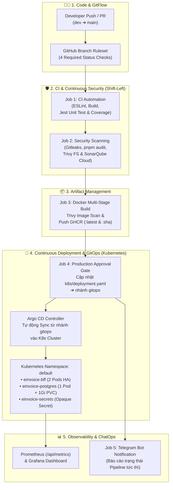

# 🧾 E-Invoice Enterprise — Hệ thống Hóa đơn Điện tử & Quy trình DevSecOps GitOps

[](https://github.com/snowyy16/e-invoice/actions/workflows/devsecops.yml)
[](https://sonarcloud.io/summary/new_code?id=snowyy16_e-invoice)


Hệ thống quản lý, ký số và tra cứu **Hóa đơn Điện tử (E-Invoice)** được xây dựng trên kiến trúc **Nx Monorepo**, tích hợp chu trình **DevSecOps CI/CD khép kín** trên GitHub Actions, triển khai tự động theo mô hình **GitOps với Argo CD trên Kubernetes** và giám sát thời gian thực bằng **Prometheus & Grafana**.

---

## 🏗️ Sơ đồ Kiến trúc DevSecOps & GitOps Pipeline



## 📂 Cấu trúc Kho lưu trữ (Nx Monorepo)

```text
e-invoice/
├── .github/workflows/
│   └── devsecops.yml           # Pipeline DevSecOps 5 giai đoạn trên GitHub Actions
├── apps/
│   ├── be/bff/                 # Backend-for-Frontend (NestJS, TypeORM, JWT, XML/Digital Signature, Prometheus Metrics)
│   └── fe/
│       ├── web-admin/          # Giao diện quản trị & kế toán (Next.js + TailwindCSS)
│       └── web-portal/         # Cổng tra cứu hóa đơn điện tử (Next.js + TailwindCSS)
├── libs/
│   ├── constants/              # Hằng số, Enum trạng thái hóa đơn & phân quyền (RBAC)
│   ├── decorators/             # Custom Decorators (@Roles)
│   ├── entities/               # TypeORM Entities (InvoiceEntity, UserEntity)
│   ├── guards/                 # JwtAuthGuard & RolesGuard
│   ├── interfaces/             # Interfaces & kiểu dữ liệu dùng chung
│   ├── schemas/                # Schema dữ liệu dùng chung
│   └── utils/                  # Tiện ích tính thuế, ký số XML, JWT & mã hóa
├── docs/k8s-examples/
│   ├── secret.example.yaml     # Mẫu Kubernetes Secret (không chứa mật khẩu thật)
│   └── alertmanager-telegram.example.yaml # Mẫu cấu hình Alertmanager gửi cảnh báo runtime qua Telegram
├── k8s/                        # Hạ tầng Kubernetes (GitOps Manifests)
│   ├── sealed-secret.yaml      # Bitnami SealedSecret đã mã hóa an toàn để commit GitOps
│   ├── postgres.yaml           # PostgreSQL 16 Deployment, Service & PersistentVolumeClaim (1Gi)
│   ├── deployment.yaml         # BFF Deployment (2 Replicas, Liveness/Readiness Probes) & Service
│   ├── monitoring.yaml         # Prometheus (Alert Rules), Alertmanager & Grafana Deployment/Service
│   └── dashboard.yaml          # ConfigMap Auto-Provisioning Grafana Dashboard (einvoice-bff-metrics)
├── .gitleaks.toml              # Cấu hình ngoại lệ cho Gitleaks (bảo vệ secret thật, tránh cảnh báo nhầm)
├── Dockerfile                  # Multi-stage Dockerfile tối ưu dung lượng & chạy non-root (USER node)
├── start-demo.ps1              # Script tự cô lập cluster E-Invoice & mở 5 cổng Port-Forward
├── sonar-project.properties    # Cấu hình phân tích mã nguồn tĩnh & LCOV Coverage cho SonarQube Cloud
└── .sonarcloud.properties      # Cấu hình loại trừ nguồn quét cho SonarCloud
```

---

## 🛠️ Công nghệ Sử dụng (Tech Stack)

| Tầng (Layer)            | Công nghệ / Công cụ                                                 | Vai trò trong hệ thống                                                                        |
| :---------------------- | :------------------------------------------------------------------ | :-------------------------------------------------------------------------------------------- |
| **Ứng dụng & CSDL**     | NestJS, Next.js, TypeScript, TypeORM, PostgreSQL 16                 | Xử lý nghiệp vụ hóa đơn điện tử, ký số XML và lưu trữ dữ liệu                                 |
| **CI & Build**          | Nx Workspace, pnpm, Jest, GitHub Actions                            | Tự động hóa kiểm tra cú pháp, biên dịch, kiểm thử đơn vị & Code Coverage                      |
| **Bảo mật (DevSecOps)** | Gitleaks, `pnpm audit`, SonarQube Cloud, Aqua Trivy, Sealed Secrets | Quét Secret, SCA, SAST, Container Image, đẩy SARIF lên GitHub Security & mã hóa Secret GitOps |
| **Đóng gói & Registry** | Docker Buildx, GitHub Container Registry (GHCR)                     | Đóng gói Multi-stage Image (`ghcr.io/snowyy16/e-invoice/bff`)                                 |
| **Hạ tầng & GitOps**    | Kubernetes (`v1.30`), Argo CD                                       | Điều phối Container có tính sẵn sàng cao (2 Replicas) và đồng bộ tự động từ nhánh `gitops`    |
| **Giám sát & Cảnh báo** | Prometheus, Alertmanager, Grafana, Telegram Bot API                 | Thu thập metrics (`/api/metrics`), luật cảnh báo runtime, Dashboard và thông báo ChatOps      |

---

## 🚀 Hướng dẫn Vận hành & Truy cập trên Kubernetes

### 1. Kiểm tra trạng thái các Pod trên Kubernetes

```bash
kubectl get pods,svc,pvc,secret -n default
```

### 2. Mở kết nối (Port-Forward) tới các dịch vụ

Chạy nhanh toàn bộ 5 cổng (tự cô lập cluster cho E-Invoice và tự động kết nối lại) bằng script PowerShell:

```powershell
.\start-demo.ps1
```

Hoặc mở thủ công từng dịch vụ:

| Dịch vụ               | Lệnh Port-Forward                                                    | Địa chỉ truy cập                   |
| :-------------------- | :------------------------------------------------------------------- | :--------------------------------- |
| **Backend BFF API**   | `kubectl port-forward svc/einvoice-bff-service -n default 3000:80`   | `http://localhost:3000/api/health` |
| **Argo CD UI**        | `kubectl port-forward svc/argocd-server -n argocd 8080:443`          | `https://localhost:8080`           |
| **Prometheus UI**     | `kubectl port-forward svc/prometheus-service -n default 9090:9090`   | `http://localhost:9090/targets`    |
| **Grafana Dashboard** | `kubectl port-forward svc/grafana-service -n default 3001:3000`      | `http://localhost:3001`            |
| **Alertmanager UI**   | `kubectl port-forward svc/alertmanager-service -n default 9093:9093` | `http://localhost:9093`            |

### 3. Mã hóa lại Kubernetes Secret (Bitnami Sealed Secrets)

Không commit file Secret dạng plaintext. Khi cần cập nhật `einvoice-secrets`, chỉnh từ [docs/k8s-examples/secret.example.yaml](docs/k8s-examples/secret.example.yaml) rồi mã hóa sang `k8s/sealed-secret.yaml`:

```powershell
kubeseal --controller-name=sealed-secrets-controller --controller-namespace=kube-system --namespace=default --format=yaml < secret-local.yaml > k8s/sealed-secret.yaml
```
