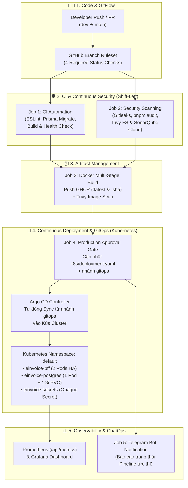

# 🧾 E-Invoice Enterprise — Hệ thống Hóa đơn Điện tử & Quy trình DevSecOps GitOps

[](https://github.com/snowyy16/e-invoice/actions/workflows/devsecops.yml)
[](https://sonarcloud.io/summary/new_code?id=snowyy16_e-invoice)


Hệ thống quản lý, ký số và tra cứu **Hóa đơn Điện tử (E-Invoice)** được xây dựng trên kiến trúc **Nx Monorepo**, tích hợp chu trình **DevSecOps CI/CD khép kín** trên GitHub Actions, triển khai tự động theo mô hình **GitOps với Argo CD trên Kubernetes** và giám sát thời gian thực bằng **Prometheus & Grafana**.

---

## 🏗️ Sơ đồ Kiến trúc DevSecOps & GitOps Pipeline



## 📂 Cấu trúc Kho lưu trữ (Nx Monorepo)

```text
e-invoice/
├── .github/workflows/
│   └── devsecops.yml           # Pipeline DevSecOps 5 giai đoạn trên GitHub Actions
├── apps/
│   ├── bff/                    # Backend-for-Frontend (NestJS, Prisma, JWT, XML/Digital Signature, Prometheus Metrics)
│   └── web/                    # Giao diện người dùng & cổng tra cứu hóa đơn (React + Vite + TailwindCSS)
├── libs/
│   ├── database/               # Prisma Schema, Migrations & Database Client dùng chung
│   ├── shared/                 # DTOs, Interfaces & Hằng số dùng chung
│   └── utils/                  # Tiện ích xử lý nghiệp vụ & mã hóa
├── k8s/                        # Hạ tầng Kubernetes (GitOps Manifests)
│   ├── secret.yaml             # Kubernetes Secret lưu trữ biến môi trường nhạy cảm
│   ├── postgres.yaml           # PostgreSQL 16 Deployment, Service & PersistentVolumeClaim (1Gi)
│   ├── deployment.yaml         # BFF Deployment (2 Replicas, Liveness/Readiness Probes) & Service
│   └── monitoring.yaml         # Prometheus & Grafana Deployment, ConfigMap & Service
├── Dockerfile                  # Multi-stage Dockerfile tối ưu hóa dung lượng & chạy non-root user
└── .sonarcloud.properties      # Cấu hình phân tích mã nguồn tĩnh SonarQube Cloud
```

---

## 🛠️ Công nghệ Sử dụng (Tech Stack)

| Tầng (Layer)            | Công nghệ / Công cụ                                 | Vai trò trong hệ thống                                                                           |
| :---------------------- | :-------------------------------------------------- | :----------------------------------------------------------------------------------------------- |
| **Ứng dụng & CSDL**     | NestJS, React, TypeScript, Prisma, PostgreSQL 16    | Xử lý nghiệp vụ hóa đơn điện tử, ký số XML và lưu trữ dữ liệu                                    |
| **CI & Build**          | Nx Workspace, pnpm, GitHub Actions                  | Tự động hóa kiểm tra cú pháp, biên dịch và kiểm thử                                              |
| **Bảo mật (DevSecOps)** | Gitleaks, `pnpm audit`, SonarQube Cloud, Aqua Trivy | Quét Secret, lỗ hổng thư viện (SCA), mã nguồn tĩnh (SAST) và quét lỗ hổng Container Image        |
| **Đóng gói & Registry** | Docker Buildx, GitHub Container Registry (GHCR)     | Đóng gói Multi-stage Image (`ghcr.io/snowyy16/e-invoice/bff`)                                    |
| **Hạ tầng & GitOps**    | Kubernetes (`v1.30`), Argo CD                       | Điều phối Container có tính sẵn sàng cao (2 Replicas) và đồng bộ tự động từ nhánh `gitops`       |
| **Giám sát & Cảnh báo** | Prometheus, Grafana, Telegram Bot API               | Thu thập chỉ số thời gian thực (`/api/metrics`), trực quan hóa Dashboard và gửi cảnh báo ChatOps |

---

## 🚀 Hướng dẫn Vận hành & Truy cập trên Kubernetes

### 1. Kiểm tra trạng thái các Pod trên Kubernetes

```bash
kubectl get pods,svc,pvc,secret -n default
```

### 2. Mở kết nối (Port-Forward) tới các dịch vụ

| Dịch vụ               | Lệnh Port-Forward                                                  | Địa chỉ truy cập                   |
| :-------------------- | :----------------------------------------------------------------- | :--------------------------------- |
| **Backend BFF API**   | `kubectl port-forward svc/einvoice-bff-service -n default 3000:80` | `http://localhost:3000/api/health` |
| **Argo CD UI**        | `kubectl port-forward svc/argocd-server -n argocd 8080:443`        | `https://localhost:8080`           |
| **Prometheus UI**     | `kubectl port-forward svc/prometheus-service -n default 9090:9090` | `http://localhost:9090/targets`    |
| **Grafana Dashboard** | `kubectl port-forward svc/grafana-service -n default 3001:3000`    | `http://localhost:3001`            |
